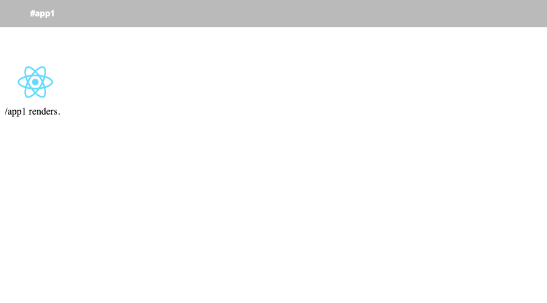

# `single-spa` inside `lerna` monorepo experiment

## Run:

- Install the dependencies
   - `$ npm install`
- Run the individual micro-apps
   - `$ npm run watch:portal`
- Then start the `root` application
   - `$ npm run portal`
- Brwose to http://localhost:9000.

## Build commands

- `$ npm run watch:portal`: builds each app as `umd (webpack output)` module with `single-spa` as middleware to be consumed by the `single-spa` root app, any changes to the ap are automatically detected.

- `$ npm run build`: builds a release bundle (outputs all contents to a folder) of the app as `umd (webpack output)` module that you can then serve from the production server.
